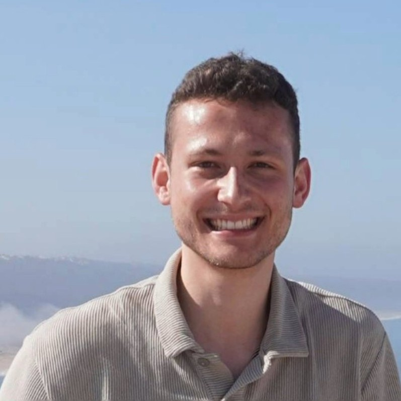

<a href="mailto:matthias.pawlik@tum.de">📧 Email</a> ·
<a href="https://github.com/MrHighsenberg">🐙 GitHub</a> ·
<a href="https://www.linkedin.com/in/matthias-pawlik">💼 LinkedIn</a>

<a href="#"><b>Home</b></a> ·
<a href="#research">Research</a> ·
<a href="#teaching--schools">Teaching &amp; Schools</a> ·
<a href="#awards--grants">Awards</a> ·
<a href="assets/pdf/Matthias_Pawlik_CV.pdf">CV</a>

matthias.pawlik@tum.de

<h1>Matthias Pawlik</h1>

<b>MSc Quantum Science and Technology (MQST)</b> 
Technical University of Munich (TUM) &amp; Ludwig Maximilian University of Munich (LMU)

<i>Last updated: November 2026</i>

---

## About

I am a physics graduate student in the joint TUM–LMU Master's program in Quantum Science and Technology. My work sits at the intersection of **quantum information theory** and **quantum many-body physics**, with a focus on tensor network methods, open quantum systems, and exactly solvable models. My academic mentor is Prof. Dr. Ignacio Cirac (MPQ).

Currently, I am working on **information scrambling in open quantum many-body systems** in the group of Prof. Dr. Ulrich Schollwöck, supervised by Dr. Sebastian Paeckel (LMU).

---

## News

- **Oct 2026** – Attending the *European Tensor Networks School 2026* at the Isaac Newton Institute for Mathematical Sciences.
- **Aug 2026** – Attending the *Bad Honnef Physics School* (DPG Physics Center) on Quantum Machine Learning.
- **Winter 2026/27** – Tutor for *Classical Mechanics* at LMU (Prof. Dr. Joachim Rädler).
- **Winter 2025/26** – Tutor for *Quantum Mechanics* at LMU (Prof. Dr. Armin Scrinzi).
- **Oct 2025** – Participated in the *Arnold Sommerfeld School 2025* on Quantum Computing: Status and Prospects.
- **Aug 2025** – Participated in the *QMATH Masterclass 2025* at the University of Copenhagen on Representation Theory in Quantum Information Science.
- **2025** – Awarded the *MQV Exchange Fellowship* (Munich Quantum Valley) and the *Rohde Scholarship* (Lothar and Sigrid Rohde Foundation).
- **Feb–Apr 2025** – Research stay at ICFO in the group of Prof. Dr. Antonio Acín.

---

## Research

### Selected work

**Information scrambling in open quantum many-body systems** 
Master's project · Chair of Theoretical Nanophysics, LMU · *in progress* 
Supervisor: Dr. Sebastian Paeckel · Prof. Dr. Ulrich Schollwöck

**Tensor network renormalization for dissipative quantum systems** 
Research internship · ICFO, Castelldefels · Group of Prof. Dr. Antonio Acín · 2025 
Implemented a tensor network renormalization method based on semidefinite programming and adapted it to efficiently and numerically certify steady-state observables of dissipative quantum systems.

**Circuits of Round-a-Face Quantum Channels: An Extension of the DUIRF Model** 
Bachelor's thesis (Grade: 1.0) · Max Planck Institute of Quantum Optics, Theory Division of Prof. Dr. Ignacio Cirac · 2024 
Supervisors: Dr. Georgios Styliaris (MPQ) · Prof. Dr. Jan von Delft (LMU)

**Space-efficient QAOA for the Traveling Salesperson Problem** 
Research assistant · Quantum Applications and Research Laboratory (QAR-Lab), Munich · 2024 
Within the QCHALLenge project, designed and implemented a QAOA circuit scheme using binary encoding of feasible solutions, applied to logistics and production line management.

---

## Education

| Degree | Institution | Period |
|---|---|---|
| M.Sc. Quantum Science and Technology | TUM / LMU Munich | since Oct 2024 |
| Erasmus year, Sciences de la Matière | École normale supérieure de Lyon | Aug 2022 – Jul 2023 |
| B.Sc. Physics (Grade: 1.32, top 10 %) | LMU Munich | Sep 2020 – Mar 2024 |
| Abitur (Grade: 1.1) | Graf-Rasso-Gymnasium Fürstenfeldbruck | 2012 – 2020 |

---

## Teaching & Schools

**Tutoring (LMU)**

- Classical Mechanics, Winter 2026/27
- Quantum Mechanics, Winter 2025/26
- Atomic and Molecular Physics, Summer 2025
- Mathematical Methods for Theoretical Physics, Winter 2023/24

**Schools & Seminars**

- European Tensor Networks School 2026, Isaac Newton Institute
- Bad Honnef Physics School 2026, Quantum Machine Learning
- Arnold Sommerfeld School 2025, LMU
- QMATH Masterclass 2025, University of Copenhagen
- ICFO Spring School 2025, Open-Source Tools for Quantum Science & Technology
- Seminar on Theoretical Quantum Computing (LMU, Nov 2024): talk on Quantum Channels
- Seminar on Dynamical Systems & Chaos Theory (ENSL, Apr 2023): talk on Internal Wave Attractors

---

## Awards & Grants

- **2025** – MQV Exchange Fellowship, Munich Quantum Valley
- **2025** – Rohde Scholarship, Lothar and Sigrid Rohde Foundation
- **2024** – Student Research Fellowship, ICFO
- **2022** – Starter-Kit Bayern France Scholarship, Franco-Bavarian University Cooperation Center
- **2020** – Abitur Award in Physics, German Physical Society (DPG)
- **2020** – Abitur Award in Mathematics, German Mathematical Society (DMV)

---

## Community

- **Student Mentor, LMU** (since Oct 2024): LMU Buddy Program for exchange students and Peer-to-Peer Mentoring for first-year physics students.
- **Network Member, DiGiQ** (since Nov 2024): Digitally Enhanced Quantum Technology Master Europe, Network for Quantum Computing.

---

## Skills

- **Programming:** Python (NumPy, TeNPy, SyTen, PyTorch, Qiskit, Matplotlib) · Julia · Mathematica · Git · LaTeX
- **Languages:** German (C2) · English (C1) · French (C1) · Spanish (A2)
- **Interests:** Amateur astronomy · Classical guitar · Chess · Running · Photography

---

<a href="mailto:matthias.pawlik@tum.de">📧 Email</a> ·
<a href="https://github.com/MrHighsenberg">🐙 GitHub</a> ·
<a href="https://www.linkedin.com/in/matthias-pawlik">💼 LinkedIn</a>

